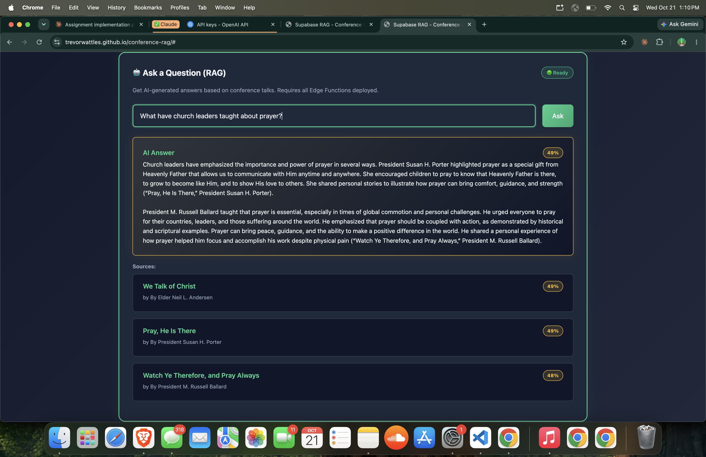

# Conference Search

Ask a question and get an answer drawn from General Conference talks, with links to every talk it used. Covers 426 talks from April 2020 to October 2025.

**Live site:** https://trevorwattles.github.io/conference-rag/ (sign in with an emailed link)



## What it does

- **Ask a question.** Retrieves the three most relevant talks and has GPT-4o write an answer from them only, citing each talk. If the talks don't cover it, the answer says so.
- **Search by meaning.** Finds passages about the same idea even when the words differ. "How can I find peace during hard times?" finds *"There is peace and joy even in hard times."*
- **Search exact words.** Classic keyword search, with matches highlighted.
- **Your questions.** Every answer is saved to your private history, so you can reread it later without another AI call.

## How it works

```
Browser (static site on GitHub Pages)
 ├─ Supabase Auth ──────── magic-link sign-in → JWT
 ├─ Postgres via PostgREST ─ keyword search (trigram index), vector search (pgvector HNSW),
 │                           question history; every query filtered by grants + row-level security
 └─ Edge Functions (Deno) ── embed-question → OpenAI text-embedding-3-small (with cache)
                             generate-answer → GPT-4o, grounded in the retrieved talks
```

The data pipeline (`scripts/`) scrapes the talks, splits them into 26,256 sentence chunks, embeds each one as a 1,536-dimension vector (about 2 cents in total), and loads them into Postgres.

## Security

- **The public key can't read the data.** The Supabase anon key ships with the site, so the database itself enforces access. Default grants are revoked, talks are readable only by signed-in users, and nothing is writable from the browser.
- **Per-user privacy.** Question history uses row-level security (`user_id = auth.uid()`), so nobody can read, change, or delete anyone else's questions, and ownership and timestamps can't be forged.
- **Secrets stay server-side.** The OpenAI key lives only in Edge Functions, which verify the caller's JWT, validate input, and enforce a per-user rate limit before spending anything.
- **Proven by tests.** `scripts/test_rls.py` (29 checks) and `scripts/test_functions.py` (19 checks) exercise every rule with the public key, as an anonymous visitor and as two separate users.

## Performance

Measured with `EXPLAIN ANALYZE` (`scripts/explain_search.py`):

| Query | Without index | With index |
|---|---|---|
| Keyword search, worst case | 91 ms (scans all 26k rows) | 0.3 ms (trigram GIN) |
| Semantic search, top 20 | 17–23 s (would exceed the 8 s timeout) | 3–8 ms (HNSW), 90–100% recall |

Cost controls (embedding cache, per-user limits, input caps) and what would change at millions of users are in [ARCHITECTURE.md](ARCHITECTURE.md).

## Stack

Vanilla HTML/CSS/JS · Supabase (Postgres, pgvector, Auth, Edge Functions) · OpenAI `text-embedding-3-small` and GPT-4o · Python data pipeline · GitHub Pages

## Repository layout

| Path | Contents |
|---|---|
| `index.html`, `app.js`, `styles.css` | The site |
| `supabase/migrations/` | Schema hardening, indexes, history, cache, and rate limit (SQL) |
| `supabase/functions/` | `embed-question`, `generate-answer`, shared auth/CORS/DB helpers |
| `scripts/` | Data pipeline (`01`–`05`), tests, query-plan and SQL helpers |
| `steps/` | The original step-by-step course guide |
| `ARCHITECTURE.md` | Design, security layers, and scaling notes |

## Run your own copy

1. Fork this repo and enable GitHub Pages (main branch, root).
2. Create a Supabase project and an OpenAI API key. Put the URL and anon key in `config.public.json`, and the rest in `config.secret.json` (git-ignored; template in `config.secret.example.json`).
3. Set up Python: `python3 -m venv .venv && source .venv/bin/activate && pip install -r requirements.txt`
4. Build the database: run `scripts/01_create_schema.py` to `05_update_embeddings.py` in order, then apply `supabase/migrations/0002`–`0006` with `python scripts/run_sql.py <file>`.
5. Deploy the functions: `supabase functions deploy embed-question --no-verify-jwt` (same for `generate-answer`), after `supabase secrets set OPENAI_API_KEY=...`.
6. Add your Pages URL to Supabase Auth redirect URLs and to `supabase/functions/_shared/cors.ts`.

The [step-by-step guides](steps/README.md) walk through each stage in detail.

## Credits

Built by Trevor Wattles for CS 452 at BYU, starting from the course's [conference-rag template](https://github.com/byu-cs-452/conference-rag), with [Claude Code](https://claude.com/claude-code) as a coding partner. Not affiliated with The Church of Jesus Christ of Latter-day Saints; talk text belongs to its publisher and links back to the original talks.
